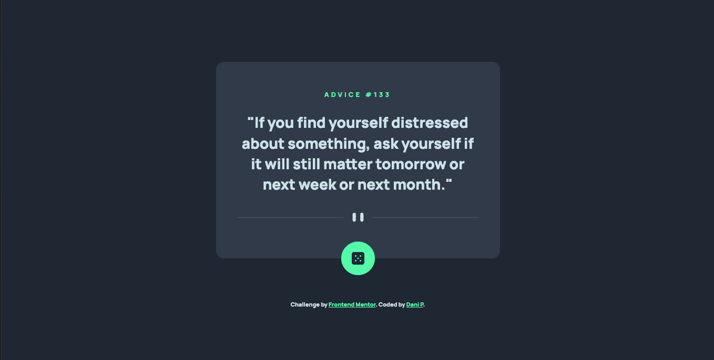

# Frontend Mentor - Advice generator app solution

This is a solution to the [Advice generator app challenge on Frontend Mentor](https://www.frontendmentor.io/challenges/advice-generator-app-QdUG-13db). Frontend Mentor challenges help you improve your coding skills by building realistic projects.

## Table of contents

- [Overview](#overview)
  - [The challenge](#the-challenge)
  - [Screenshot](#screenshot)
  - [Links](#links)
- [My process](#my-process)
  - [Built with](#built-with)
  - [What I learned](#what-i-learned)
  - [Continued development](#continued-development)
  - [Useful resources](#useful-resources)
  - [AI Collaboration](#ai-collaboration)
- [Author](#author)
- [Acknowledgments](#acknowledgments)

## Overview

### The challenge

Users should be able to:

- View the optimal layout for the app depending on their device's screen size
- See hover states for all interactive elements on the page
- Generate a new piece of advice by clicking the dice icon

### Screenshot



### Links

- GitHub Repository: [Advice Generator App](https://github.com/daniellepenz123/advice-generator-app)
- Live Site URL: [Advice Generator App](https://daniellepenz123.github.io/advice-generator-app/)

## My process

### Built with

- HTML5
- CSS3
- Flexbox
- Responsive design with media queries
- JavaScript
- Fetch API
- Advice Slip API

### What I learned

This challenge helped me practice and retain more of what I've been learning in class. I got more practice working with APIs, JavaScript, and CSS, and putting everything together to make a really cool, responsive working app! I also learned how to customize a README file for my project as I have never done that before.

Here's some code I'm proud of from this project:

```html
<button class="dice-button" type="button" aria-label="Get new advice">
  
</button>
```
```css
.dice-button:hover {
  box-shadow: 0 0 25px hsl(150, 100%, 66%);
}
```
```js
function getAdvice() {
  fetch("https://api.adviceslip.com/advice")
    .then((res) => res.json())
    .then((data) => {
      document.querySelector(".advice-id").textContent =
        `ADVICE #${data.slip.id}`;
      document.querySelector(".advice-text").textContent =
        `"${data.slip.advice}"`;
    })
    .catch((err) => console.error("API error:", err));
}
```

### Continued development

I want to keep getting better at JavaScript, working with APIs, and making my projects responsive/accessible. I'm looking forward to building more projects myself and getting more and more comfortable with doing things on my own.

### Useful resources

- [Advice Slip API](https://api.adviceslip.com/) - The API I used to get random advice for the app.
- [Frontend Mentor](https://www.frontendmentor.io/) - Provided the challenge and design files.

### AI Collaboration

I used ChatGPT to help me troubleshoot some issues and answer questions like how to open README files on my Mac before even opening it up in VS Code. The step-by-step answers were helpful. I also got help learning how to work on a README in VS Code for the first time.

## Author

- GitHub - [Dani P](https://github.com/daniellepenz123)
- Frontend Mentor - [daniellepenz123](https://www.frontendmentor.io/profile/daniellepenz123)
- Personal Website - [daniellepenz.com](https://www.daniellepenz.com)

## Acknowledgments

Thanks to Frontend Mentor for providing this challenge and AnnieCannons for helping me build my coding skills!